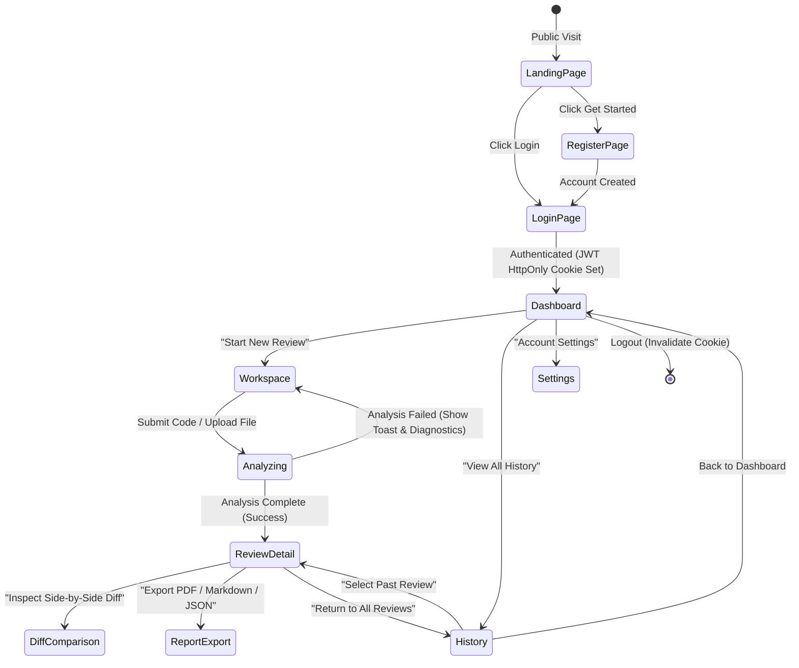
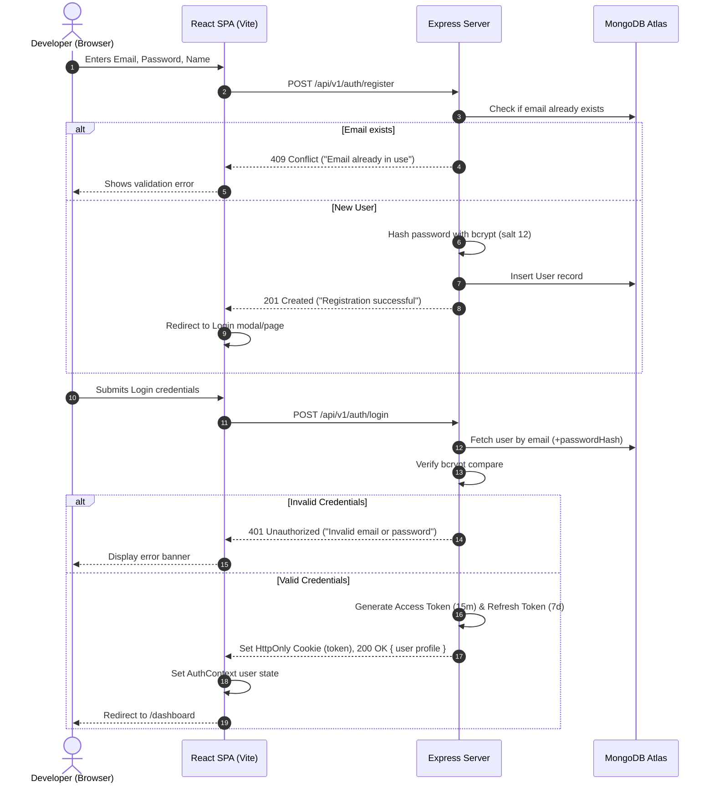
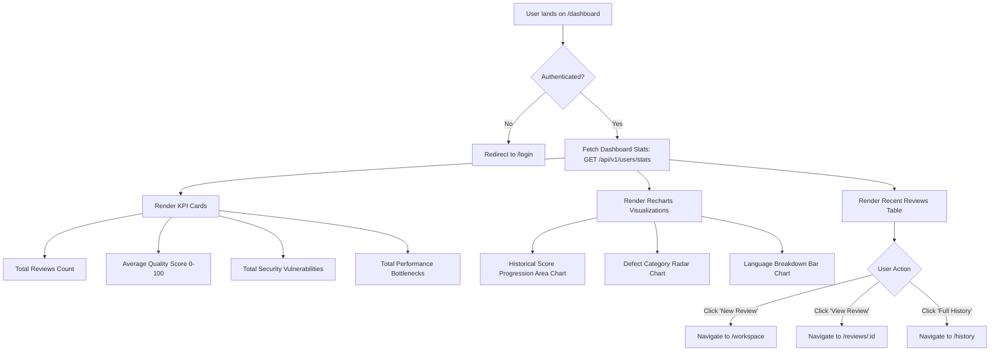
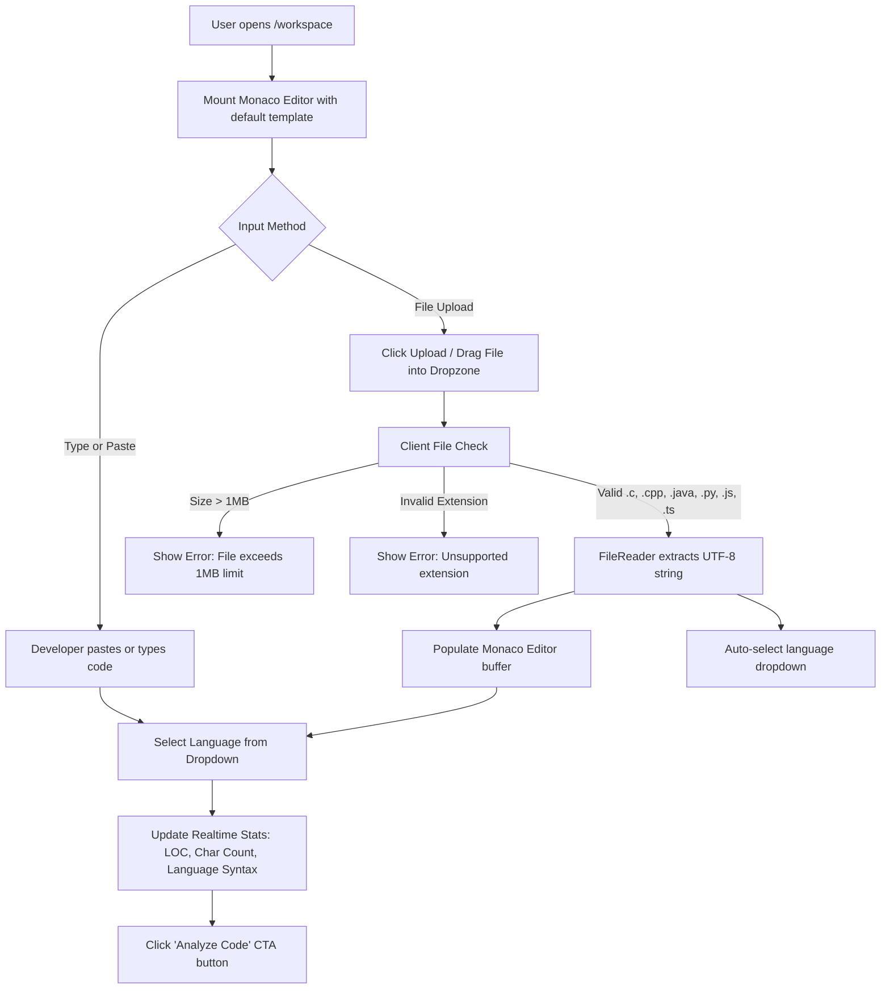
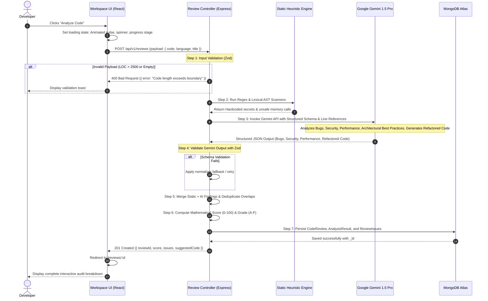
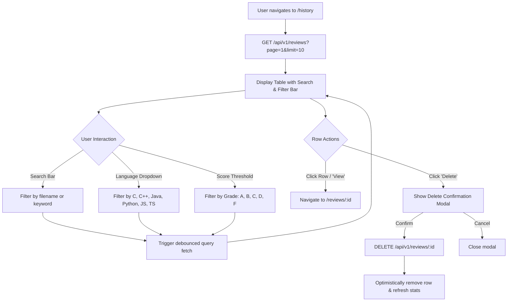
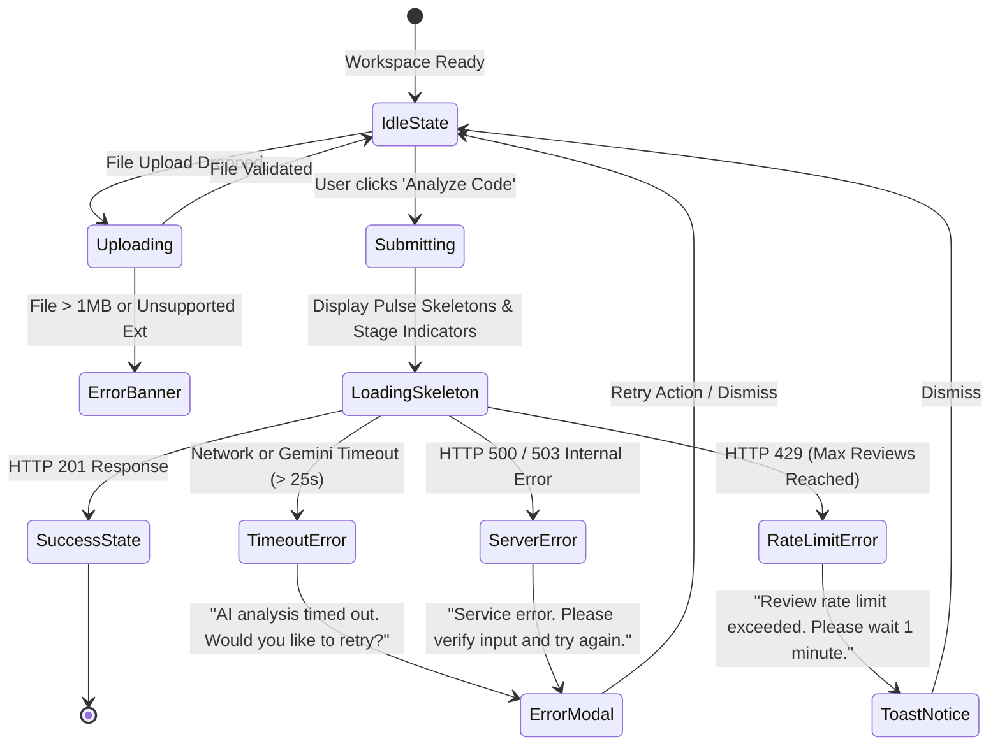

# Application Flow Document (APP_FLOW.md)

## Project Name: AI Code Review
**Project Title**: Intelligent AI-Powered Code Analysis & Review Platform  
**Document Version**: 1.0.0  
**Status**: Architecture Approved  

---

## 1. Global User Journey & System Map

The following state diagram outlines the top-level user lifecycle, from initial landing to workspace code review, report generation, and historical audits.



---

## 2. Authentication Flow

### 2.1 User Registration & Login Sequence
Authentication relies on salted `bcrypt` password hashing, short-lived JWT access tokens, and persistent `HttpOnly` refresh cookies.



---

## 3. Dashboard Navigation & Analytics Flow

The Dashboard provides immediate visibility into code quality telemetry, review volume, and defect distributions.



---

## 4. Code Review Workspace Flow (Editor & Ingestion)

The workspace supports both direct typing in the **Monaco Code Editor** and single-file drag-and-drop / file browser uploads.



---

## 5. Dual-Layer AI Code Analysis Pipeline Flow

When the user clicks **"Analyze Code"**, the backend executes deterministic static checks before delegating deeper reasoning to Google Gemini.



---

## 6. Review Results & Side-by-Side Code Comparison Flow

The Review Results interface gives developers granular insight into every detected flaw and provides a side-by-side diff comparison for instant remediation.

```mermaid
flowchart TD
    Enter[User reaches /reviews/:id] --> Load[Load Analysis Summary]
    
    Load --> TopBanner[Display Score Badge: e.g., 88/100 Grade B]
    TopBanner --> MetricsBar[Issue Counters: Critical, High, Medium, Low]
    
    MetricsBar --> MainGrid[Interactive Workspace Layout]
    
    subgraph LeftPanel[Source Code Inspection]
        Editor[Monaco Editor with Line Gutter Markers]
    end
    
    subgraph RightPanel[Categorized Findings Tabs]
        Tabs[Tabs: All Issues | Bugs | Security | Performance | Best Practices]
        Tabs --> IssueList[Filterable Cards List]
        IssueList --> Card[Issue Card: Severity Badge, Title, Line Reference]
    end
    
    Card -->|Click 'Locate in Code'| ScrollLine[Monaco Editor jumps & highlights affected line]
    Card -->|Click 'View Solution'| ExpandSol[Displays rationale, impact, and patch snippet]
    
    MainGrid --> DiffCTA[Click 'Inspect Side-by-Side Diff' Button]
    DiffCTA --> ModalDiff[Open Monaco Diff Viewer Modal]
    
    ModalDiff --> DiffView[Original Code (Left) vs Improved Suggested Code (Right)]
    DiffView --> CopyBtn[Click 'Copy Refactored Code' button]
    CopyBtn --> Clipboard[Copied to Clipboard toast notification]
```

---

## 7. Review History & Archive Management Flow

Developers can revisit, search, filter, and purge historical code reviews.



---

## 8. Reports & Export Workflow

Developers can generate and download audit documentation for homework submission, compliance records, or peer discussion.

```mermaid
flowchart TD
    Init[User clicks 'Export Report' on /reviews/:id] --> Options{Choose Format}
    
    Options -->|Markdown (.md)| GenMD[Generate structured Markdown with headings & code blocks]
    GenMD --> DownloadMD[Trigger client-side browser file download: review-audit.md]
    
    Options -->|JSON (.json)| GenJSON[Compile raw API schema & issues array]
    GenJSON --> DownloadJSON[Trigger browser download: review-data.json]
    
    Options -->|Print / PDF| GenPrint[Apply @media print styling: Clean white background, no sidebars]
    GenPrint --> BrowserPrint[Trigger window.print() system print / Save as PDF dialog]
```

---

## 9. Error Handling & Loading States

Every critical path handles transient failures, upstream timeouts, and invalid inputs gracefully.


