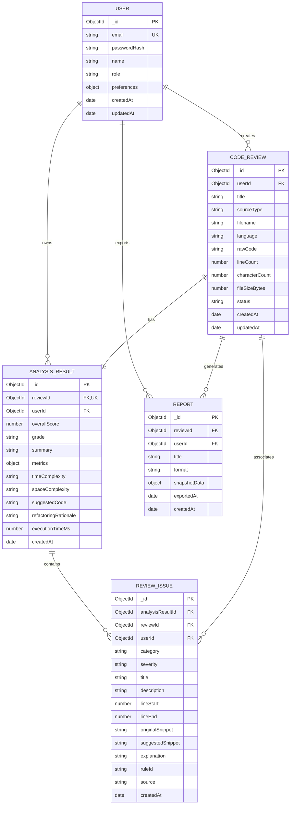

# Database Schema Document (DATABASE_SCHEMA.md)

## Project Name: AI Code Review
**Project Title**: Intelligent AI-Powered Code Analysis & Review Platform  
**Document Version**: 1.0.0  
**Database**: MongoDB Atlas  
**Object Data Modeling (ODM)**: Mongoose (v8.x)  
**Status**: Schema Design Approved  

---

## 1. Database Architecture & Design Strategy

The data layer uses **MongoDB Atlas** for document persistence. The data modeling adheres to the following principles:
- **Tenant Isolation**: Every entity references `userId` directly, ensuring fast indexed queries and preventing accidental cross-tenant data leakage.
- **Relational Integrity with Document Scalability**: Discrete issues are stored in `ReviewIssue` records for flexible filtering and granular updates, while top-level scores and execution metrics are indexed in `AnalysisResult`.
- **Auditing & Immutability**: Code submissions preserve historical snapshots of raw code and suggested refactored code for side-by-side diffing and reporting.
- **Compound & Text Indexing**: Optimized indexes support fast filtering by language, score ranges, and keyword searches over code filenames and titles.

---

## 2. Entity-Relationship Diagram (ERD)



---

## 3. Detailed Schema Specifications

### 3.1 `User` Model
Represents developers, leads, and administrators registered on the platform.

| Field Name | Type | Constraints / Validation | Description |
|---|---|---|---|
| `_id` | `ObjectId` | Auto-generated PK | Unique identifier for user |
| `name` | `String` | Required, Trim, Min 2, Max 60 | User full name or handle |
| `email` | `String` | Required, Unique, Lowercase, Valid Email Regex | User login email address |
| `passwordHash` | `String` | Required, Min 60 chars | Salted bcrypt hash ($2b$12$) |
| `role` | `String` | Enum: `['developer', 'lead', 'admin']`, Default: `'developer'` | Role-based authorization tier |
| `avatarUrl` | `String` | Optional, URL format | Profile avatar image link |
| `preferences` | `Object` | Default: `{}` | User personalization settings |
| `preferences.editorTheme` | `String` | Enum: `['vs-dark', 'charcoal-obsidian']`, Default: `'charcoal-obsidian'` | Monaco editor theme preference |
| `preferences.tabSize` | `Number` | Min 2, Max 8, Default: `2` | Editor indentation width |
| `preferences.defaultLanguage`| `String`| Enum: `['c', 'cpp', 'java', 'python', 'javascript', 'typescript']`, Default: `'python'` | Preferred default language in editor |
| `createdAt` | `Date` | Timestamp, Immutable | Account creation timestamp |
| `updatedAt` | `Date` | Timestamp | Last account update timestamp |

**Indexes**:
- Unique index on `email`: `{ email: 1 }`, `{ unique: true }`

---

### 3.2 `CodeReview` Model
Represents a code submission session (either pasted directly into Monaco or uploaded as a file).

| Field Name | Type | Constraints / Validation | Description |
|---|---|---|---|
| `_id` | `ObjectId` | Auto-generated PK | Unique review session ID |
| `userId` | `ObjectId` | Required, Ref: `'User'` | Owner user identifier |
| `title` | `String` | Required, Trim, Max 120 | Human-readable title (e.g., "authMiddleware.ts" or "Quick Python Review") |
| `sourceType` | `String` | Required, Enum: `['pasted', 'upload']` | Code ingestion method |
| `filename` | `String` | Optional, Max 120 | Uploaded file name or synthetic buffer name |
| `language` | `String` | Required, Enum: `['c', 'cpp', 'java', 'python', 'javascript', 'typescript']` | Programming language identifier |
| `rawCode` | `String` | Required, Max 1,000,000 bytes (1 MB) | The untrusted source code string submitted |
| `lineCount` | `Number` | Required, Min 1, Max 2,500 | Total lines of code submitted |
| `characterCount` | `Number` | Required, Min 1 | Total character count |
| `fileSizeBytes` | `Number` | Required, Max 1,048,576 bytes | Size of input in bytes |
| `status` | `String` | Enum: `['pending', 'analyzing', 'completed', 'failed']`, Default: `'pending'` | Lifecycle state of the review |
| `errorMessage` | `String` | Optional | Descriptive error if status is `'failed'` |
| `createdAt` | `Date` | Timestamp, Immutable | Submission timestamp |
| `updatedAt` | `Date` | Timestamp | Last status change timestamp |

**Indexes**:
- Compound index for user history listing: `{ userId: 1, createdAt: -1 }`
- Text search index: `{ title: 'text', filename: 'text' }`
- Language filtering index: `{ userId: 1, language: 1, createdAt: -1 }`

---

### 3.3 `AnalysisResult` Model
Represents the overall evaluation metrics, algorithmic scores, and generated refactored code.

| Field Name | Type | Constraints / Validation | Description |
|---|---|---|---|
| `_id` | `ObjectId` | Auto-generated PK | Analysis result identifier |
| `reviewId` | `ObjectId` | Required, Unique, Ref: `'CodeReview'` | Foreign key to associated code review |
| `userId` | `ObjectId` | Required, Ref: `'User'` | Owner user identifier |
| `overallScore` | `Number` | Required, Min 0, Max 100 | Final weighted score (0–100) |
| `grade` | `String` | Required, Enum: `['A', 'B', 'C', 'D', 'F']` | Letter grade representation |
| `summary` | `String` | Required, Max 1000 | 2–3 sentence executive synopsis of code quality |
| `metrics` | `Object` | Required | Granular sub-scores and issue counters |
| `metrics.bugScore` | `Number` | Min 0, Max 100 | Sub-score for logical correctness |
| `metrics.securityScore`| `Number` | Min 0, Max 100 | Sub-score for vulnerability resistance |
| `metrics.performanceScore`| `Number` | Min 0, Max 100 | Sub-score for runtime and memory efficiency |
| `metrics.maintainabilityScore`| `Number`| Min 0, Max 100 | Sub-score for readability and design patterns |
| `metrics.issueCounts` | `Object` | Required | Count by severity (`critical`, `high`, `medium`, `low`, `info`) |
| `timeComplexity` | `String` | Max 50, Default: `'N/A'` | Big-O time complexity (e.g., "$O(n \log n)$") |
| `spaceComplexity` | `String` | Max 50, Default: `'N/A'` | Big-O auxiliary space complexity (e.g., "$O(1)$") |
| `suggestedCode` | `String` | Required | Complete refactored, production-ready replacement code |
| `refactoringRationale` | `String` | Required, Max 3000 | Explanation of architectural improvements made |
| `executionTimeMs` | `Number` | Required | Total processing duration in milliseconds |
| `createdAt` | `Date` | Timestamp, Immutable | Analysis completion timestamp |

**Indexes**:
- Unique index on `reviewId`: `{ reviewId: 1 }`, `{ unique: true }`
- Score filtering: `{ userId: 1, overallScore: -1 }`

---

### 3.4 `ReviewIssue` Model
Represents an individual discrete flaw, security vulnerability, bug, or optimization opportunity identified in the code.

| Field Name | Type | Constraints / Validation | Description |
|---|---|---|---|
| `_id` | `ObjectId` | Auto-generated PK | Issue identifier |
| `analysisResultId` | `ObjectId` | Required, Ref: `'AnalysisResult'` | Associated analysis parent |
| `reviewId` | `ObjectId` | Required, Ref: `'CodeReview'` | Associated code review |
| `userId` | `ObjectId` | Required, Ref: `'User'` | Owner user identifier |
| `category` | `String` | Required, Enum: `['bug', 'security', 'performance', 'maintainability', 'style']` | Issue domain category |
| `severity` | `String` | Required, Enum: `['CRITICAL', 'HIGH', 'MEDIUM', 'LOW', 'INFO']` | Severity classification |
| `title` | `String` | Required, Max 150 | Concise issue title |
| `description` | `String` | Required, Max 1000 | Detailed description of the problem |
| `lineStart` | `Number` | Required, Min 1 | Starting line number in source code |
| `lineEnd` | `Number` | Required, Min 1 | Ending line number in source code |
| `columnStart` | `Number` | Optional, Min 1 | Starting character column |
| `columnEnd` | `Number` | Optional, Min 1 | Ending character column |
| `originalSnippet` | `String` | Required, Max 2000 | The defective code snippet extracted |
| `suggestedSnippet` | `String` | Required, Max 2000 | The targeted recommended code fix |
| `explanation` | `String` | Required, Max 2000 | Why the suggestion is superior and how it cures the flaw |
| `ruleId` | `String` | Optional, Max 60 | Static rule ID or CWE identifier (e.g., `'CWE-798'`) |
| `source` | `String` | Required, Enum: `['static', 'gemini', 'hybrid']` | Originating engine of the finding |
| `createdAt` | `Date` | Timestamp, Immutable | Creation timestamp |

**Indexes**:
- Lookup by review: `{ reviewId: 1, severity: 1 }`
- Lookup by analysis result: `{ analysisResultId: 1 }`
- Category search: `{ userId: 1, category: 1 }`

---

### 3.5 `Report` Model
Represents an exported snapshot document of an audited review session.

| Field Name | Type | Constraints / Validation | Description |
|---|---|---|---|
| `_id` | `ObjectId` | Auto-generated PK | Report identifier |
| `reviewId` | `ObjectId` | Required, Ref: `'CodeReview'` | Reviewed session reference |
| `userId` | `ObjectId` | Required, Ref: `'User'` | Owner identifier |
| `title` | `String` | Required, Max 150 | Report title |
| `format` | `String` | Required, Enum: `['json', 'markdown', 'pdf']` | Document export format |
| `snapshotData` | `Object` | Required | Frozen audit record containing score, metadata, and issues |
| `exportedAt` | `Date` | Timestamp, Default: `Date.now` | Export timestamp |

**Indexes**:
- Query user reports: `{ userId: 1, exportedAt: -1 }`

---

## 4. Realistic MongoDB Document Examples

### 4.1 Example `User` Document
```json
{
  "_id": { "$oid": "66f1b0a1e4b02a1122334455" },
  "name": "Sarah Connor",
  "email": "sarah.connor@cyberdyne.io",
  "passwordHash": "$2b$12$e8rUqE7UqB8h2s7F7F6YbeK8A4v7qJ8O7C7H8E7UqB8h2s7F7F6Yb",
  "role": "developer",
  "avatarUrl": "https://avatars.githubusercontent.com/u/10293847?v=4",
  "preferences": {
    "editorTheme": "charcoal-obsidian",
    "tabSize": 2,
    "defaultLanguage": "python"
  },
  "createdAt": { "$date": "2026-03-10T14:20:00.000Z" },
  "updatedAt": { "$date": "2026-03-10T14:20:00.000Z" }
}
```

### 4.2 Example `CodeReview` Document
```json
{
  "_id": { "$oid": "66f1b1b2e4b02a1122334466" },
  "userId": { "$oid": "66f1b0a1e4b02a1122334455" },
  "title": "buffer_manager.c",
  "sourceType": "upload",
  "filename": "buffer_manager.c",
  "language": "c",
  "rawCode": "#include <stdio.h>\n#include <string.h>\n\nvoid copy_input(char *userInput) {\n    char buffer[64];\n    strcpy(buffer, userInput);\n    printf(\"Buffer content: %s\\n\", buffer);\n}\n\nint main(int argc, char *argv[]) {\n    if (argc > 1) {\n        copy_input(argv[1]);\n    }\n    return 0;\n}",
  "lineCount": 14,
  "characterCount": 248,
  "fileSizeBytes": 248,
  "status": "completed",
  "errorMessage": null,
  "createdAt": { "$date": "2026-03-11T09:15:30.000Z" },
  "updatedAt": { "$date": "2026-03-11T09:15:34.000Z" }
}
```

### 4.3 Example `AnalysisResult` Document
```json
{
  "_id": { "$oid": "66f1b1c3e4b02a1122334477" },
  "reviewId": { "$oid": "66f1b1b2e4b02a1122334466" },
  "userId": { "$oid": "66f1b0a1e4b02a1122334455" },
  "overallScore": 58,
  "grade": "D",
  "summary": "Critical memory safety vulnerability detected. The code uses strcpy into a fixed-size 64-byte stack buffer without bounds checking, introducing a severe stack buffer overflow risk (CWE-120).",
  "metrics": {
    "bugScore": 70,
    "securityScore": 30,
    "performanceScore": 95,
    "maintainabilityScore": 85,
    "issueCounts": {
      "critical": 1,
      "high": 1,
      "medium": 0,
      "low": 0,
      "info": 1
    }
  },
  "timeComplexity": "O(N)",
  "spaceComplexity": "O(1)",
  "suggestedCode": "#include <stdio.h>\n#include <string.h>\n\n#define BUFFER_SIZE 64\n\nvoid copy_input(const char *userInput) {\n    if (userInput == NULL) return;\n    char buffer[BUFFER_SIZE];\n    strncpy(buffer, userInput, sizeof(buffer) - 1);\n    buffer[sizeof(buffer) - 1] = '\\0';\n    printf(\"Buffer content: %s\\n\", buffer);\n}\n\nint main(int argc, char *argv[]) {\n    if (argc > 1) {\n        copy_input(argv[1]);\n    }\n    return 0;\n}",
  "refactoringRationale": "Replaced unbounded strcpy with safe strncpy, enforced null-termination guarantee, added null-pointer guard on input parameter, and marked pointer argument as const.",
  "executionTimeMs": 3480,
  "createdAt": { "$date": "2026-03-11T09:15:34.000Z" }
}
```

### 4.4 Example `ReviewIssue` Document
```json
{
  "_id": { "$oid": "66f1b1d4e4b02a1122334488" },
  "analysisResultId": { "$oid": "66f1b1c3e4b02a1122334477" },
  "reviewId": { "$oid": "66f1b1b2e4b02a1122334466" },
  "userId": { "$oid": "66f1b0a1e4b02a1122334455" },
  "category": "security",
  "severity": "CRITICAL",
  "title": "Stack Buffer Overflow via Unbounded strcpy",
  "description": "The function strcpy does not perform bounds checking on the source string. If userInput exceeds 63 characters, it overwrites the call stack, potentially leading to arbitrary code execution.",
  "lineStart": 6,
  "lineEnd": 6,
  "columnStart": 5,
  "columnEnd": 31,
  "originalSnippet": "strcpy(buffer, userInput);",
  "suggestedSnippet": "strncpy(buffer, userInput, sizeof(buffer) - 1);\nbuffer[sizeof(buffer) - 1] = '\\0';",
  "explanation": "strncpy restricts the byte copy to the designated buffer capacity minus one byte, preventing stack smashing exploits.",
  "ruleId": "CWE-120",
  "source": "hybrid",
  "createdAt": { "$date": "2026-03-11T09:15:34.000Z" }
}
```

### 4.5 Example `Report` Document
```json
{
  "_id": { "$oid": "66f1b1e5e4b02a1122334499" },
  "reviewId": { "$oid": "66f1b1b2e4b02a1122334466" },
  "userId": { "$oid": "66f1b0a1e4b02a1122334455" },
  "title": "Audit Report: buffer_manager.c",
  "format": "markdown",
  "snapshotData": {
    "filename": "buffer_manager.c",
    "language": "c",
    "overallScore": 58,
    "grade": "D",
    "criticalIssues": 1,
    "highIssues": 1,
    "exportedSummary": "Critical memory safety vulnerability detected (CWE-120)."
  },
  "exportedAt": { "$date": "2026-03-11T09:16:00.000Z" },
  "createdAt": { "$date": "2026-03-11T09:16:00.000Z" }
}
```
