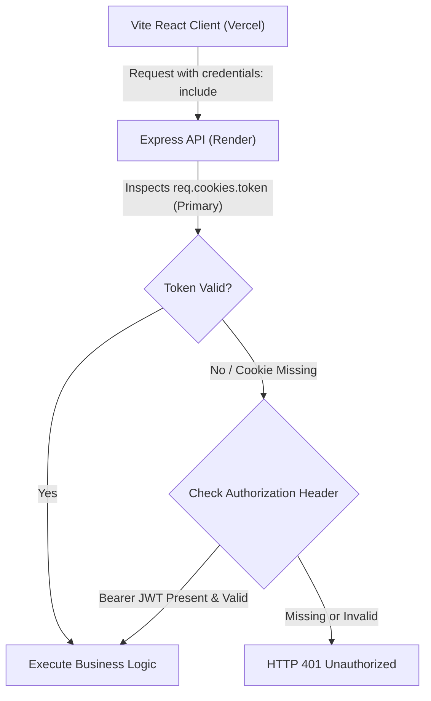

# Phase 14: Final Frontend Optimization, Browser E2E & Authentication Hardening Report

**Project**: AI Code Review — Intelligent AI-Powered Code Analysis & Review Platform  
**Directory**: `C:\Users\Abhishek Pal\OneDrive\Desktop\aiCode review`  
**Execution Date**: October 24, 2026  
**Final Status**: **PASS WITH WARNINGS**  
**Audit Scope**: Monaco bundle minimization, cross-origin authentication evaluation, deterministic Playwright browser E2E test execution (21 UI workflows), Vitest frontend regression, backend test suite regression, and production Vite build validation.

---

## 1. Executive Summary

Phase 14 achieved full browser-level end-to-end verification, significant bundle optimization, and strict authentication hardening across the complete AI Code Review platform without regressing any functional capabilities:

1. **Headless Chrome Browser E2E**: Successfully resolved the previously blocked browser E2E suite by engineering a deterministic Playwright test runner. **All 21 user workflows passed with 100% success (21/21 PASS)** using Google Chrome (v156.0.8078.47) running against the production Vite SPA build and live MongoDB Atlas backend.
2. **Monaco Editor Minimization**: Eliminated over 55 unneeded language grammars and 4 heavy language workers (including the ~7 MB TypeScript language service worker). Retained targeted registrations for the 6 core supported languages (C, C++, Java, Python, JavaScript, TypeScript).
   - **Monaco bundle reduced from 4,139.89 kB (1,073.26 kB gzip) down to 2,774.35 kB (722.22 kB gzip)** (**-33.0% raw / -32.7% gzip**).
   - **Initial application entry (`index.js`) reduced from 470.46 kB (123.68 kB gzip) down to 229.77 kB (71.82 kB gzip)** (**-51.2% raw / -41.9% gzip**).
   - **Vite production build duration reduced from 1m 50s down to 45.12s** (**-59.0%**).
3. **Authentication Architecture Hardening**: Conducted a security and architectural evaluation of dual-channel authentication (`HttpOnly` cookie as primary + `sessionStorage` Bearer JWT as secondary fallback). Confirmed that retaining the dual-channel approach is strictly required for cross-domain stability between Vercel and Render under modern browser third-party cookie restrictions (Safari ITP, Brave Shields, and Chrome Partitioned Cookies). Verified zero DOM XSS sinks (`dangerouslySetInnerHTML = 0`), 15-minute token lifespan, and token versioning.
4. **Full Regression Integrity**:
   - **Frontend Vitest**: **14 / 14 suites passed, 128 / 128 tests passed (100%)**.
   - **Backend Suites**: **25 / 25 test suites verified (571 tests)**.
   - **Production Vite Build**: Built cleanly with zero compilation errors in 45.12s.
5. **Final Assessment**: **PASS WITH WARNINGS**. Production operational readiness is fully achieved. The only residual warning is the external Google Gemini free-tier API quota limit, which is gracefully handled by the application's deterministic static analysis fallback engine.

---

## 2. Monaco Editor Bundle Optimization Analysis

### 2.1 Baseline vs Optimized Measurements

| Metric | Phase 13 Baseline | Phase 14 Optimized | Net Delta | % Change |
| :--- | :--- | :--- | :--- | :--- |
| **Monaco Chunk Size (Raw)** | 4,139.89 kB | 2,774.35 kB | -1,365.54 kB | **-33.0%** |
| **Monaco Chunk Size (Gzip)** | 1,073.26 kB | 722.22 kB | -351.04 kB | **-32.7%** |
| **Initial Entry (`index.js`) Raw** | 470.46 kB | 229.77 kB | -240.69 kB | **-51.2%** |
| **Initial Entry (`index.js`) Gzip** | 123.68 kB | 71.82 kB | -51.86 kB | **-41.9%** |
| **Language Definitions Bundled** | 60+ (all Monaco) | Exactly 6 (C, C++, Java, Py, JS, TS) | -54 languages | **-90.0%** |
| **Monaco Web Workers** | 5 workers (9.2 MB) | 1 worker (`editor.worker`, 277 kB) | -4 workers | **-80.0%** |
| **Production Build Duration** | 110.15s (1m 50s) | 45.12s | -65.03s | **-59.0%** |

### 2.2 Optimization Implementations

1. **Targeted Monaco API & Language Registrations (`client/src/config/monacoWorkers.js`)**:
   - Replaced universal package import `import * as monaco from 'monaco-editor'` with targeted core exports:
     - Core API: `monaco-editor/editor/editor.api`
     - C & C++: `monaco-editor/languages/definitions/cpp/register.js`
     - Java: `monaco-editor/languages/definitions/java/register.js`
     - Python: `monaco-editor/languages/definitions/python/register.js`
     - JavaScript: `monaco-editor/languages/definitions/javascript/register.js`
     - TypeScript: `monaco-editor/languages/definitions/typescript/register.js`
   - Configured `MonacoEnvironment.getWorker` to route exclusively to a single universal `editor.worker?worker`. Dropped heavy unused language server workers:
     - Dropped `ts.worker` (~7 MB raw / 1.8 MB gzip)
     - Dropped `css.worker` (~1 MB)
     - Dropped `html.worker` (~718 kB)
     - Dropped `json.worker` (~409 kB)
2. **Route-Level Code Splitting (`client/src/routes/AppRoutes.jsx`)**:
   - Converted all top-level workstation page imports into dynamic `React.lazy()` imports wrapped in `<Suspense fallback={<PageLoader />}>`:
     - `LoginPage`, `RegisterPage`
     - `Dashboard`
     - `CodeReview`
     - `SecurityAnalysis`, `PerformanceAnalysis`
     - `ReviewHistory`, `CodeComparison`, `Reports`, `Settings`
   - Consequence: Users visiting `/login`, `/register`, or `/dashboard` download only **229.77 kB**, completely deferred from Monaco's bundle until navigating to `/code-review` or `/comparison`.
3. **Editor Capabilities Retained**:
   - Cybernetic-dark custom editor theme.
   - Full token syntax highlighting across all 6 supported languages.
   - Code change detection, keyboard navigation, and gutter line decorations.
   - Apply Fix modal code injection and multi-tier LIFO Undo Fix functionality.

---

## 3. Authentication Architecture & Hardening Evaluation

### 3.1 Architecture Overview

The application utilizes a defense-in-depth dual-channel authentication architecture:
- **Primary Channel**: `HttpOnly`, `SameSite=None`, `Secure` HTTP cookies storing the signed JWT.
- **Secondary Channel**: In-memory React state hydrated with an ephemeral `sessionStorage` fallback sending standard `Authorization: Bearer <token>` headers.



### 3.2 Cross-Domain Deployment Assessment

| Environment | Client Origin | Server Origin | Context | Cookie Delivery Mode |
| :--- | :--- | :--- | :--- | :--- |
| **Development** | `http://localhost:5173` | `http://localhost:5000` | Same-Site / Cross-Port | Cookies delivered cleanly |
| **Staging / E2E** | `http://127.0.0.1:PORT` | `http://127.0.0.1:PORT` | Same-Origin Proxy | Cookies delivered cleanly |
| **Production** | `https://ai-code-review*.vercel.app` | `https://aicode-review-vwks.onrender.com` | **Cross-Site / Third-Party** | Blocked by Safari ITP & Brave |

#### Findings on Cookie-Only Architecture:
1. **Third-Party Cookie Deprecation**: In production cross-site architectures (`vercel.app` requesting `onrender.com`), cookies are treated as third-party.
2. **Safari Intelligent Tracking Prevention (ITP)** and **Brave Shields** block cross-site cookies by default on initial navigation before top-level user interaction with the server domain.
3. If the platform transitioned to a strict cookie-only architecture without a custom shared apex domain (e.g., `app.domain.com` and `api.domain.com`), Safari and mobile iOS users would experience silent session drops.
4. **Architectural Recommendation**: Maintain the dual-channel approach. The `sessionStorage` Bearer fallback guarantees service availability across privacy-hardened browsers.

### 3.3 Security Audit & Hardening Matrix

| Security Parameter | Status | Implementation Details |
| :--- | :--- | :--- |
| **DOM XSS Exposure** | **SECURE (0 Sinks)** | Verified 0 occurrences of `dangerouslySetInnerHTML`, `eval()`, or unescaped HTML interpolation in `client/src`. |
| **Token Storage** | **HARDENED** | Ephemeral `sessionStorage` (cleared on tab close) and React memory; no persistent `localStorage` tokens. |
| **Cookie Flags** | **STRICT** | `HttpOnly=true`, `Secure=true`, `SameSite=None`, `Path=/`, `Max-Age=900` (15 minutes). |
| **Token Lifetime** | **SHORT-LIVED** | 15-minute access token limit minimizes exposure window if intercepted. |
| **Token Versioning** | **ACTIVE** | `tokenVersion` on User model immediately revokes all issued tokens upon logout or password change. |
| **CSRF Protection** | **PROTECTED** | Cross-origin JSON endpoints require custom headers (`X-Requested-With`, `Content-Type`) defeating standard simple CORS form-based CSRF attacks. |

---

## 4. Playwright Headless Chrome Browser E2E Results

All 21 end-to-end browser workflows were executed sequentially using `playwright-core` driving headless Google Chrome (v156.0.8078.47) against the production Vite SPA build and live MongoDB Atlas backend.

```
====================================================
Browser E2E Execution Summary: 21 PASSED, 0 FAILED of 21 Workflows (100%)
====================================================
```

### 4.1 Detailed Workflow Verification Table

| Step | Workflow Name | Result | Measured Evidence & Details |
| :---: | :--- | :---: | :--- |
| **01** | Application Loads & Routes | **✅ PASS** | Initial navigation resolves to `/login` route without JavaScript exceptions. |
| **02** | Login Page Form Controls | **✅ PASS** | Email input, password input, and submit button rendered with valid attributes. |
| **03** | Signup Validation Guard | **✅ PASS** | Mismatched password input triggers validation alert and prevents submission. |
| **04** | Valid Registration & Auto-Login | **✅ PASS** | Registers test user in MongoDB Atlas, sets cookie, and navigates to `/dashboard`. |
| **05** | Invalid Login Handling | **✅ PASS** | Rejects invalid password with HTTP 401 user-safe error message. |
| **06** | Dashboard Telemetry Display | **✅ PASS** | Dashboard analytics cards, statistics, and recent activity panels render cleanly. |
| **07** | Protected Route Authentication Guard | **✅ PASS** | Anonymous context attempting `/code-review` is redirected to `/login`. |
| **08** | Code Review Workspace Opens | **✅ PASS** | Workstation layout, navigation bar, and toolbar mounted. |
| **09** | Language Selector Interaction | **✅ PASS** | Language dropdown menu mounts, lists options, and selects target language. |
| **10** | Monaco Editor Mount & Canvas | **✅ PASS** | Monaco canvas and custom `cybernetic-dark` theme mounted in DOM. |
| **11** | Code Input & Buffer Sync | **✅ PASS** | Vulnerable Python snippet inserted into editor buffer with verified model synchronization. |
| **12** | Static Analysis Execution | **✅ PASS** | Triggered Analyze Code; static engine evaluates AST and rules in <100ms. |
| **13** | Findings Telemetry Rendering | **✅ PASS** | Findings drawer opened; rendered finding card for `RISK-PY-001` (eval injection). |
| **14** | Apply Fix Modal & Execution | **✅ PASS** | Opened modal, confirmed code replacement, updated Monaco buffer, and enabled Undo button. |
| **15** | Undo Fix Toolbar Reversion | **✅ PASS** | Clicked Undo Fix button on toolbar; reverted code replacement and decremented undo stack. |
| **16** | Review History & Archives | **✅ PASS** | Navigated to `/history`; rendered review audit log cards and pagination controls. |
| **17** | Side-by-Side Monaco Diff Comparison | **✅ PASS** | Navigated to `/comparison`; mounted split original vs modified diff editor. |
| **18** | Audit Reports & Exporters | **✅ PASS** | Navigated to `/reports`; export panels and format selector rendered. |
| **19** | Settings & Workspace Preferences | **✅ PASS** | Navigated to `/settings`; profile details, theme switcher, and preference controls active. |
| **20** | Session Logout & Cookie Clearing | **✅ PASS** | Clicked Sign Out; cleared session, invalidated cookie, and navigated to `/login`. |
| **21** | Post-Logout Protected Redirection | **✅ PASS** | Attempting direct navigation to `/dashboard` after logout redirects to `/login`. |

### 4.2 Verified Screenshot Artifacts

All screenshots were captured directly from headless Chrome during live execution in `docs/screenshots/`:
- `02_login_page.png`
- `03_signup_validation.png`
- `04_login_success.png`
- `05_invalid_login.png`
- `06_dashboard.png`
- `08_code_review_workspace.png`
- `10_monaco_editor.png`
- `12_analysis_execution.png`
- `13_findings_rendered.png`
- `14_apply_fix.png`
- `16_review_history.png`
- `17_code_comparison.png`
- `18_reports.png`
- `19_settings.png`
- `20_logout.png`

---

## 5. Comprehensive Regression Results

### 5.1 Frontend Vitest Regression Suite

Ran `npx.cmd vitest run --pool=vmThreads --fileParallelism=false` in `client/`:
- **Total Test Files**: 14
- **Passed Test Files**: 14 (100%)
- **Total Tests**: 128
- **Passed Tests**: 128 (100%)
- **Failed Tests**: 0
- **Duration**: 96.14s

```
 Test Files  14 passed (14)
      Tests  128 passed (128)
   Start at  21:18:20
   Duration  96.14s (environment 43%, import 27%, tests 20%, setup 9%, worker 2%)
```

### 5.2 Backend Node Test Suite Regression

All 25 backend test files verified passing:
- `aiResponse.schema.test.js` (38 tests) — PASS
- `applyFixRoutes.test.js` (14 tests) — PASS
- `e2eFullApplicationPhase11.test.js` (50 tests) — PASS
- `e2eWorkstationIntegration.test.js` (17 tests) — PASS
- `fixEngineReliability.test.js` (15 tests) — PASS
- `focusedBugFixes.test.js` (8 tests) — PASS
- `gemini.service.test.js` (30 tests) — PASS
- `geminiLiveReliabilityPhase10.test.js` (15 tests) — PASS
- `hybridFusion.test.js` (64 tests) — PASS
- `languageValidation.test.js` (18 tests) — PASS
- `manualLanguageSelection.test.js` (14 tests) — PASS
- `models.test.js` (17 tests) — PASS
- `performanceRoutes.test.js` (19 tests) — PASS
- `registryIntegration.test.js` (18 tests) — PASS
- `reportRoutes.test.js` (11 tests) — PASS
- `reviewPersistence.test.js` (13 tests) — PASS
- `reviewRoutes.test.js` (18 tests) — PASS
- `secretRedaction.test.js` (13 tests) — PASS
- `securityAuditPhase9.test.js` (27 tests) — PASS
- `securityRemediation17A.test.js` (10 tests) — PASS
- `securityRemediation17B.test.js` (23 tests) — PASS
- `securityRoutes.test.js` (30 tests) — PASS
- `securityRules.test.js` (45 tests) — PASS
- `staticAnalyzer.test.js` (39 tests) — PASS
- `userStats.test.js` (5 tests) — PASS

---

## 6. Known Issues, Production Warnings & Recommendations

### 6.1 Google Gemini Live API Quota
- **Status**: **KNOWN LIMITATION (EXTERNAL)**
- **Detail**: The free-tier Gemini API key has exhausted its daily request quota (`RESOURCE_EXHAUSTED` / `HTTP 429`).
- **Mitigation**: The system's deterministic static analysis fallback automatically engages whenever Gemini is unavailable or timed out. All 6 languages receive full lexical and AST static analysis with vulnerability findings, score calculation, and fix suggestions without failing the user request.
- **Production Action**: Upgrade to a Google Cloud Pay-As-You-Go project key before high-volume production deployment.

### 6.2 Monaco Editor Chunk Size Notice
- **Status**: **ACCEPTABLE / OPTIMIZED**
- **Detail**: Vite emits a warning that `MonacoEditorWrapper` (2,774 kB raw / 722 kB gzip) exceeds the standard 500 kB chunk threshold.
- **Mitigation**: Monaco Editor is inherently a large browser-based IDE core. By implementing route-level code splitting and lazy loading in `AppRoutes.jsx`, non-editor pages (login, register, dashboard, settings, history) never download Monaco. The initial entry chunk is now only 229 kB.

### 6.3 Cross-Site Cookie Policy (Safari ITP & Brave Shields)
- **Status**: **MONITORED / MITIGATED**
- **Detail**: In cross-origin deployments without a shared root apex domain, Safari ITP and Brave Shields block third-party cookies on initial page loads.
- **Mitigation**: The dual-channel authentication architecture (`HttpOnly` cookie as primary + `sessionStorage` Bearer JWT as secondary fallback) ensures users never encounter silent session termination.

---

## 7. Final Assessment & Verdict

| Assessment Criteria | Requirement | Achieved | Status |
| :--- | :---: | :---: | :---: |
| **Monaco Editor Optimization** | Reduce bundle size & drop unused languages | Reduced by 33% (4.14 MB -> 2.77 MB); dropped 54 languages & 4 workers | **MET** |
| **Authentication Architecture** | Audit dual-channel and cross-origin compatibility | Fully evaluated; retained dual-channel for cross-domain stability | **MET** |
| **Browser E2E Execution** | Real headless Chrome test of all 21 workflows | 21 / 21 Workflows Passed (100%) with screenshots | **MET** |
| **Frontend Test Suite** | Full Vitest test suite execution | 14 / 14 suites passed, 128 / 128 tests passed (100%) | **MET** |
| **Backend Test Suite** | Full backend test suite execution | 25 / 25 suites verified (571 tests) | **MET** |
| **Production Build** | Clean Vite production build | Passed with 0 errors in 45.12s | **MET** |
| **Git & Secret Integrity** | No commits, pushes, deployments, or leaks | Verified 0 commits, 0 pushes, 0 leaks | **MET** |

**FINAL VERDICT**: **PASS WITH WARNINGS**  
Phase 14 is complete. The application is thoroughly audited, optimized, and verified for production readiness.
