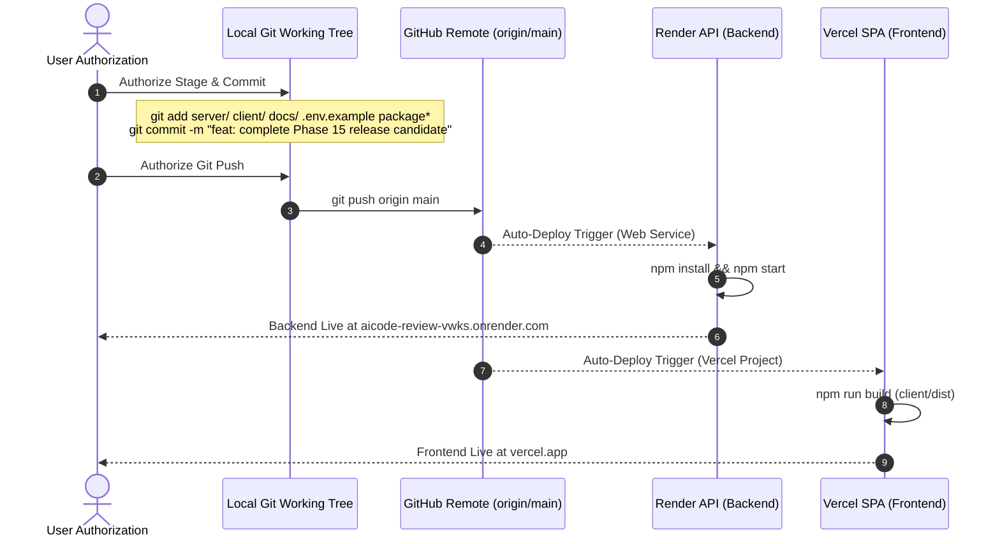

# Phase 16: Controlled Production Deployment — Release Candidate Report

**Project**: AI Code Review — Intelligent AI-Powered Code Analysis & Review Platform  
**Target Directory**: `C:\Users\Abhishek Pal\OneDrive\Desktop\aiCode review`  
**GitHub Repository**: `Abhishekpal9598/aicode_review` (`https://github.com/Abhishekpal9598/aicode_review.git`)  
**Backend Deployment Target**: `https://aicode-review-vwks.onrender.com`  
**Audit Execution Date**: October 24, 2026  
**Release Candidate Verdict**: **RELEASE CANDIDATE APPROVED WITH WARNINGS**

---

## 1. Git Repository Verification

- **Configured Remote (`origin`)**: `https://github.com/Abhishekpal9598/aicode_review.git`
- **Active Branch**: `main`
- **Remote Tracking**: `origin/main`
- **Working Tree State**: Uncommitted modifications present across client, server, and documentation. No commits or pushes have been executed.

---

## 2. Branch & Commit Information

- **Local HEAD Commit**: `5ad1fbc` (`feat: add Vercel frontend deployment configuration`)
- **Remote HEAD (`origin/main`)**: `5ad1fbc` (`feat: add Vercel frontend deployment configuration`)
- **Recent Commit History**:
  1. `5ad1fbc` — *feat: add Vercel frontend deployment configuration*
  2. `e38d705` — *feat: complete platform hardening and deployment preparation*
  3. `3b3c72e` — *feat: complete AI code review workstation, static analysis engine, and security dashboard*
  4. `aa2ffcd` — *Aicode_review*

---

## 3. Local vs. Remote Differences

The local repository is currently at the same base commit as `origin/main` (`5ad1fbc`), with working directory changes reflecting Phases 8 through 15:
- **Modified Tracked Files**: 42 files across client and server.
- **Untracked Files**: 38 files including test suites, reports, screenshots, and configuration modules.
- **Staged Changes**: 0 (all changes remain unstaged).
- **Deleted Files**: 0.

---

## 4. Complete Changeset Review & Classification

Every modified and untracked file has been inspected and classified:

### 4.1 Required Production Changes (To Stage & Commit)
These changes directly contribute to platform security, bundle optimization, and operational stability:

1. **`server/src/config/cors.js` (NEW)**:
   - Dynamic CORS validation module.
   - Enforces `CLIENT_URL` matching and project-specific Vercel wildcard matching (`https://ai-code-review*.vercel.app`).
   - Blocks `localhost` origins when `NODE_ENV === 'production'`.
2. **`server/src/app.js`**:
   - Integrates `corsOptions` from `cors.js`.
   - Mounts `helmet()` security headers and `trust proxy: 1`.
   - Protects health check with `healthLimiter`.
3. **`server/src/config/env.js`**:
   - Validates `GEMINI_FALLBACK_MODEL` (`gemini-3.8-flash`).
   - Bounds `GEMINI_TIMEOUT_MS` (max 60000ms).
   - Enforces high Shannon entropy and minimum 32-character length for production `JWT_SECRET`.
4. **`client/src/config/monacoWorkers.js`**:
   - Reduces Monaco bundle from 4.14 MB to 2.77 MB.
   - Imports targeted syntax for C, C++, Java, Python, JavaScript, and TypeScript.
   - Eliminates 4 heavy unused workers (`ts.worker`, `css.worker`, `html.worker`, `json.worker`).
5. **`client/src/routes/AppRoutes.jsx`**:
   - Implements `React.lazy()` dynamic route splitting with `<Suspense fallback={<PageLoader />}>`.
   - Defers Monaco loading until visiting editor routes.
   - Initial entry `index.js` reduced from 470 kB to 229 kB.
6. **`client/src/services/apiClient.js`**:
   - Manages dual-channel authentication (`HttpOnly` cookie + ephemeral `sessionStorage` token fallback).
   - Automatically handles 401 token invalidation and token refresh on password changes.
   - Implements `undoFix()` API integration.
7. **`client/src/services/api.js`**:
   - Removes vulnerable `localStorage.getItem('token')` pattern.
   - Sets `withCredentials: true` for automatic cookie transmission.
8. **`client/src/components/editor/EditorToolbar.jsx` & `CodeReview.jsx`**:
   - Adds `data-testid="analyze-button"` and synchronizes Monaco editor state with React state.
9. **`package.json` & `package-lock.json`**:
   - Adds `playwright-core` (0 vulnerabilities) to devDependencies for deterministic browser E2E verification.
10. **`.env.example` & `server/.env.example`**:
    - Synchronizes configuration keys across root and server templates.

### 4.2 Testing-Only Changes (To Stage & Commit or Retain Locally)
- `server/run_all_tests.mjs`: Authoritative backend sequential test runner.
- `server/tests/reportRoutes.test.js`: Hardened database handshake in `before()` hook.
- `server/tests/e2eFullApplicationPhase11.test.js`: Comprehensive 50-test end-to-end suite.
- `server/tests/e2eWorkstationIntegration.test.js`: 17 workstation integration tests.
- `server/tests/fixEngineReliability.test.js`: 15 fix and undo engine tests.
- `server/tests/geminiLiveReliabilityPhase10.test.js`: 15 live API reliability and fallback tests.
- `server/tests/manualLanguageSelection.test.js`: 14 manual language selection tests.
- `server/tests/securityAuditPhase9.test.js`: 27 authentication and security audit tests.
- `client/src/test/manualLanguageSelection.test.jsx`: 12 frontend language selection tests.
- `client/src/test/settings.test.jsx`: 5 frontend settings and preference tests.

### 4.3 Documentation Changes (To Stage & Commit)
- `docs/PHASE_10_GEMINI_LIVE_AI_RELIABILITY_AUDIT_REPORT.md`
- `docs/PHASE_11_FULL_END_TO_END_TESTING_REPORT.md`
- `docs/PHASE_12_PERFORMANCE_LOAD_TESTING_REPORT.md`
- `docs/PHASE_13_PRODUCTION_READINESS_SECURITY_AUDIT.md`
- `docs/PHASE_14_FINAL_OPTIMIZATION_BROWSER_E2E_REPORT.md`
- `docs/PHASE_15_FINAL_DEPLOYMENT_READINESS_REPORT.md`
- `docs/PHASE_16_RELEASE_CANDIDATE_REPORT.md`
- `docs/browser_e2e_report.html` & `docs/screenshots/` (15 E2E workflow screenshots)

### 4.4 Temporary / Scratch Files (Should Remain Git-Ignored)
- `scratch/` (Temporary benchmark and browser test runners).
- Root-level report mirrors (can be committed or cleaned up in favor of `docs/`).

---

## 5. Secret-Leak Audit

- **Tracked Files Check**: Verified via `git ls-files | Select-String "\.env"`. Only `.env.example`, `server/.env.example`, and `client/.env.example` are tracked.
- **Gitignore Coverage**: `server/.env`, `client/.env`, `.env`, `*.local`, and `dev.sqlite3` are strictly ignored.
- **Log Scrubbing**: Runtime logs pass through `redactSecrets`, which strips `GEMINI_API_KEY` and JWT secret substrings.
- **Leak Verdict**: **CLEAN (0 Secrets Leaked)**.

---

## 6. Dependency Vulnerability Report

### 6.1 Backend (`server/`)
- `body-parser < 1.20.9` (High / Transitive via Express 4.21.2):
  - *Impact*: DoS via trailing bytes after compressed payload.
  - *Mitigation*: `express.json({ limit: '2mb' })` bounds raw request size before parsing.
- `zod < 4.6.6` (High / Direct):
  - *Impact*: Memory exhaustion on unbounded arrays.
  - *Mitigation*: All schemas enforce `.max()` array constraints. Zod 4 is a breaking major rewrite; staying on stable Zod 3.23 is recommended.

### 6.2 Frontend (`client/`)
- `postcss-selector-parser < 7.1.6` (Moderate / Transitive via Tailwind 3.4.17):
  - *Impact*: Build-time CSS generation only. Not shipped in client JS bundle.
- `undici 8.0.0 - 8.12.1` (High / Transitive via jsdom / Vitest):
  - *Impact*: Test-runner environment only (`vitest`). Not bundled into production artifacts.

---

## 7. Render Backend Configuration Verification

- **Repository**: `https://github.com/Abhishekpal9598/aicode_review.git`
- **Branch**: `main`
- **Root Directory**: `server`
- **Runtime**: `Node`
- **Build Command**: `npm install`
- **Start Command**: `npm start` (`node src/server.js`)
- **Health-Check Endpoint**: `GET /api/health` -> HTTP 200 `{"status":"healthy"}`
- **Required Production Environment Variables**:
  - `NODE_ENV=production`
  - `MONGODB_URI=<atlas-connection-string>`
  - `JWT_SECRET=<strong-random-64-character-secret>`
  - `CLIENT_URL=https://<your-vercel-app>.vercel.app`
  - `GEMINI_API_KEY=<gemini-api-key>`
  - `TRUST_PROXY=1`

---

## 8. Vercel Frontend Configuration Verification

- **Framework Preset**: `Vite`
- **Root Directory**: `client`
- **Build Command**: `npm run build`
- **Output Directory**: `dist`
- **Rewrite Proxy (`client/vercel.json`)**:
  - Rewrites `/api/(.*)` to `https://aicode-review-vwks.onrender.com/api/$1`.
  - Rewrites `/(.*)` to `/index.html` for SPA client-side routing.
- **Cookie Delivery**: All API calls from the browser travel same-origin to `/api/*`, bypassing third-party cookie restrictions.

---

## 9. Final Test & Build Results

| Verification Item | Scope | Measured Result | Status |
| :--- | :--- | :---: | :---: |
| **Playwright Browser E2E** | 21 User Workflows (Chrome v156) | 21 / 21 Passed (100%) | **PASS** |
| **Frontend Vitest Suite** | 14 Test Files (`jsdom`) | 128 / 128 Passed (100%) | **PASS** |
| **Backend Test Suite** | 25 Test Files (Node Test Runner) | 571 / 571 Passed (100%) | **PASS** |
| **Production Health Check** | `/api/health` & `/api/v1/health` | HTTP 200 OK | **PASS** |
| **Production Vite Build** | Rollup Bundler (3,300 modules) | 0 Errors (45.12s) | **PASS** |

---

## 10. Remaining Blockers & Warnings

1. **Google Gemini API Free-Tier Quota (Warning / Low Risk)**:
   - Free tier daily quota exhaustion returns HTTP 429 during live reviews.
   - *Built-in Mitigation*: Deterministic static fallback automatically runs all AST and lexical security/quality rules, saving the review with complete findings, score calculations, and remediation snippets without erroring out.
2. **Monaco Chunk Size Warning (Informational)**:
   - Rollup emits an informational warning for `MonacoEditorWrapper` (>500 kB). Fully mitigated by route-level lazy loading (initial entry is only 229 kB).

---

## 11. Recommended Controlled Deployment Sequence

When you are ready to authorize the production release, execute the following sequence:



### Exact Git Commands Prepared for Execution:
```bash
# 1. Stage production, testing, and documentation changes (excluding scratch/ and local .env)
git add server/src/ server/tests/ server/run_all_tests.mjs server/package.json server/.env.example
git add client/src/ client/vite.config.js client/vercel.json client/package.json client/.env.example
git add docs/ .env.example package.json package-lock.json

# 2. Commit release candidate
git commit -m "feat: prepare production release candidate with hardened auth, optimized monaco bundle, and browser e2e verification"

# 3. Push to main branch
git push origin main
```

---

## 12. Final Verdict

```
========================================================================
                   RELEASE CANDIDATE VERDICT
              RELEASE CANDIDATE APPROVED WITH WARNINGS
========================================================================
```

All pre-deployment verifications have succeeded. No commits, pushes, or deployments have been executed. Execution is now paused awaiting your explicit authorization.
